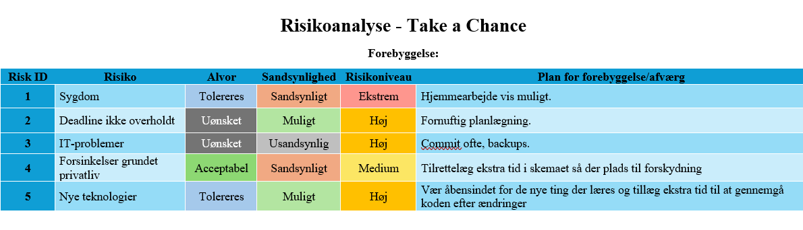

## Uge 5-8:
Disse uger var problematiske.
 
Den såkaldte API nøgle jeg havde fået mistede jeg...
  Google kunne ikke lide jeg havde lavet en ny konto til det formål, dermed blev den lukket ned.
Jeg fik derefter vejledningshjælp om der var en anden jeg kunne købe adgang til. Så blev bekendt med OpenAI.
 
Hvilket betød at user story 2 ikke behøvede at blive helt fjernet fra fremtid ønsker.
Da denne api kan genere spørgsmål ud fra mine ønsker.
 
Men jeg besluttede mig for at sige der kun skulle fokuseres på at lave det ene spil først. Dog valgte jeg at gøre så akitekturen tillader senere at jeg kan kode flere spil ind og bruge samme klasser.
 
Men intet skal gå lige til, jeg blev syg, og ikke nok med det så ugen efter da jeg blev rask, var der problemmer med en visdomstand...
 
For at gøre det kort var resultat var 2 1/2 uges sengenlæggende efter 2 operationer. Jeg var på fuld smertestillende samt pencilin og mit hoved fungerede ikke til noget.  
 
Dermed skette der ikke rigtig noget fremgang på koden, men dette er eksempel på hvor såbar man er som enkelt person.
 

### Trusler-Risikoanalyse:

